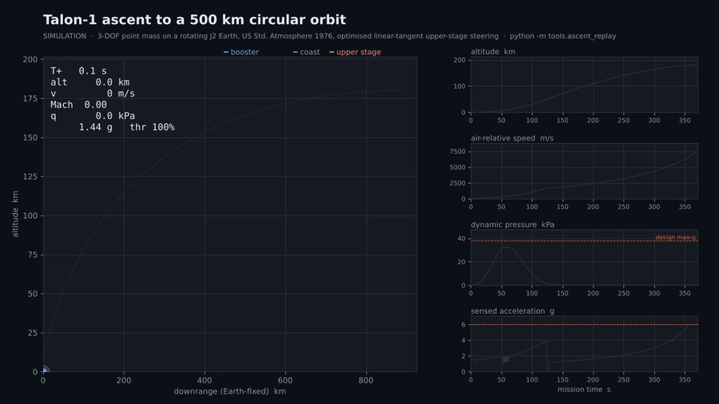
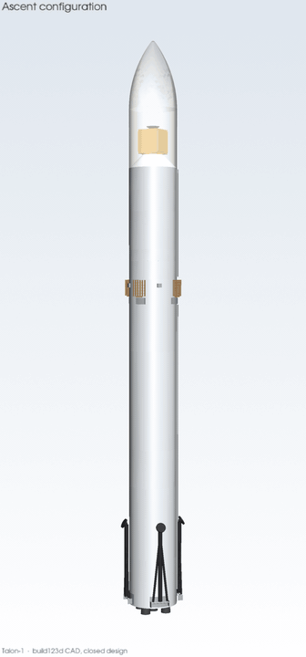
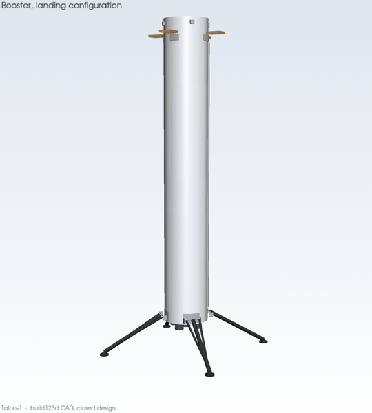
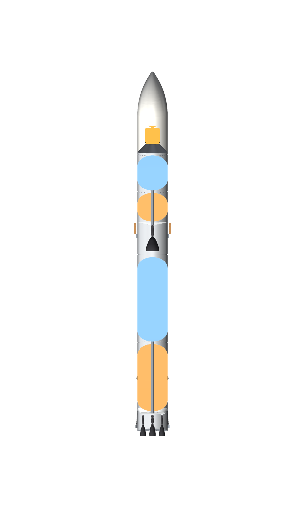
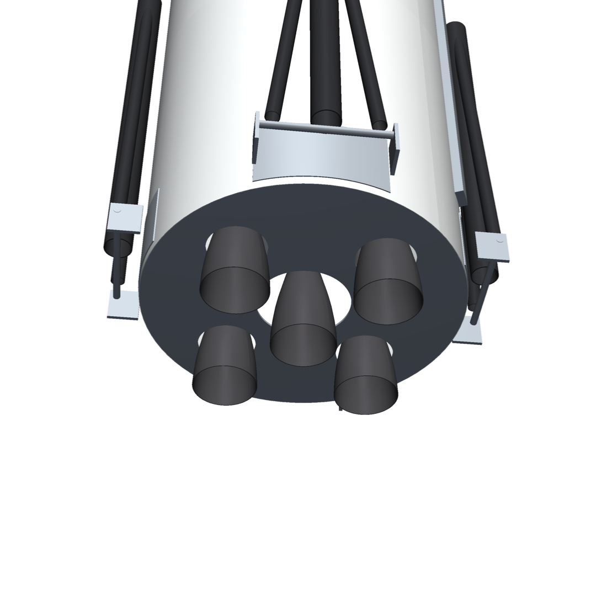
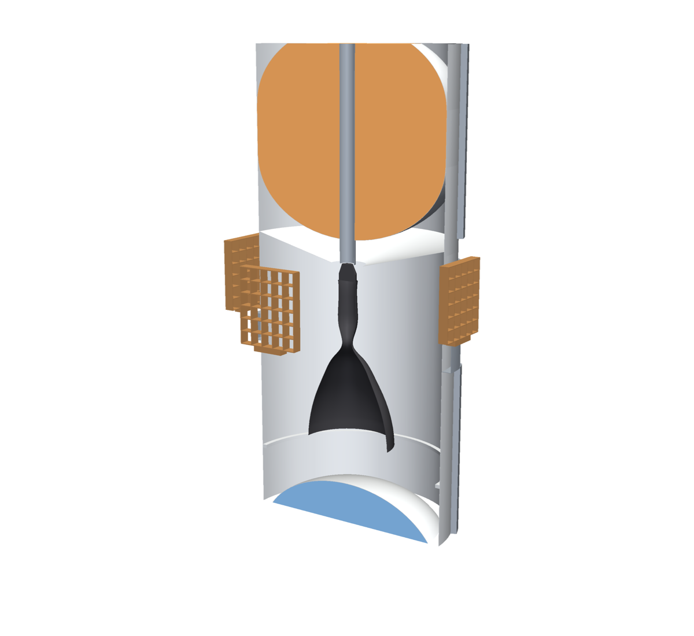
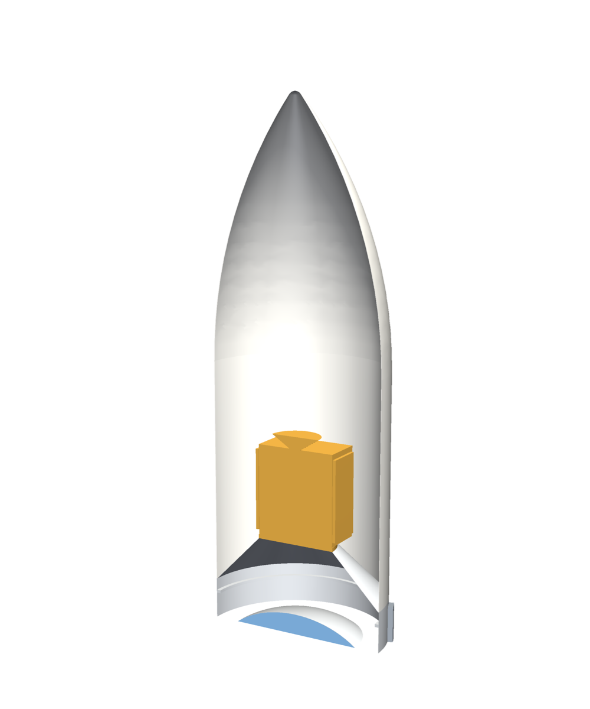

# Talon: reusable launch vehicle design + 6-DOF GNC

A small reusable rocket designed in code (sizing, build123d CAD, aero, structures) and flown in a
validated 6-DOF simulator: optimal ascent, boostback, and a fuel-optimal propulsive landing
(lossless-convexification / G-FOLD) compared against an RL policy, with the landing flight software
run hardware-in-the-loop on the Vortex-V RISC-V core. Plan and milestones: [docs/PLAN.md](docs/PLAN.md).

## Status
- **M0 (6-DOF core)**: quaternion rigid body with variable mass and inertia, RK4, point-mass/J2/uniform
  gravity, US Standard Atmosphere 1976. Analytic regression suite.
- **M1 (vehicle design)**: two-stage sizing with a booster recovery reserve, thin-wall structural sizing
  (pressure, axial, max-q bending, SP-8007 buckling), parametric build123d CAD, and a closure loop that
  re-sizes the vehicle on the dry mass measured from the CAD solids. Summary:
  [docs/design/M1-design.md](docs/design/M1-design.md). The CAD was then audited and polished
  (interference, swept-motion, validity and clearance checks on every build, real engines, A-frame
  legs, flow-facing grid fins, blunted ogive fairing): [docs/design/CAD-AUDIT.md](docs/design/CAD-AUDIT.md).
  Closed design: 24.7 t lift-off, 5 x 70 kN booster engines.

- **M2 (aero + ascent)**: Mach-dependent drag and slender-body normal force, a 3-DOF ascent on a
  rotating Earth with J2, a zero-alpha gravity turn with max-q and 6 g throttling, and optimised
  linear-tangent upper-stage steering. Talon-1 reaches a 500 km circular orbit with 159 kg of
  upper-stage propellant to spare; max-q 32 kPa against a 38 kPa design value.
  Summary: [docs/design/M2-ascent.md](docs/design/M2-ascent.md).

## Gallery



<sub>**Simulation.** M2 3-DOF ascent replay generated by `python -m tools.ascent_replay` from the committed guidance
(full-quality [MP4](docs/media/ascent-replay.mp4)). The 6-DOF TVC loop, boostback and landing are later milestones.</sub>

| Ascent stack | Booster, landing configuration | Section |
|:---:|:---:|:---:|
|  |  |  |

| Aft end | Interstage | Fairing and payload |
|:---:|:---:|:---:|
|  |  |  |

<sub>CAD turntables: `python -m tools.turntable` (pyvista off-screen; needs a display, e.g. `xvfb-run -a`).
Stills: `python -m cad.render`. All from the closed, audited build123d model.</sub>

## Verify
```
pip install -r requirements.txt
pytest -q tests/
python -m cad.build      # closes the design, runs the audit, writes build/ (STEP, STL) + docs/design/*.md
python -m cad.audit      # interference / swept / validity / clearance audit
python -m cad.render     # docs/design/renders/*.png
python -m sim.fly --mission ascent   # docs/design/M2-ascent.{md,png}
python -m gnc.ascent_opt             # re-optimise gnc/ascent_params.yaml (reviewed change)
python -m tools.ascent_replay        # docs/media/ascent-replay.{gif,mp4}
xvfb-run -a python -m tools.turntable  # docs/media/turntable-*.{gif,mp4}
```
