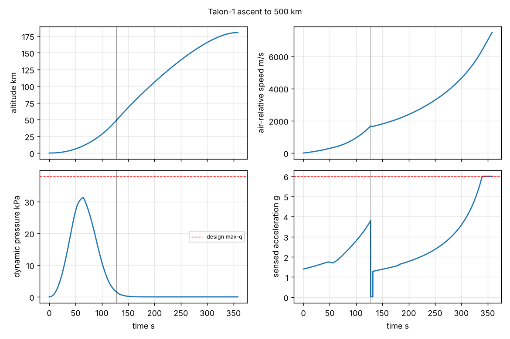

# Talon-1 M2 ascent

Generated by `python -m sim.fly --mission ascent`. Guidance parameters from `gnc/ascent_params.yaml`
(regenerate with `python -m gnc.ascent_opt`).

| Event | Value |
|---|---|
| Guidance | kick 2.074 deg, upper theta0 32.44 deg, c 0.00360 1/s |
| Max-q | 31.3 kPa at T+65 s, 11.0 km, Mach 1.40 (design 38 kPa) |
| Max sensed acceleration | 6.00 g (limit 6.0 g, throttled) |
| MECO / staging | T+127.9 s, 49.3 km, 1674 m/s air-relative, flight path 32.4 deg |
| Fairing separation | T+181.5 s, 92.5 km |
| SECO | T+358.5 s, insertion orbit 179.9 x 500.0 km |
| Apogee circularisation | 91.2 m/s, 25.7 kg |
| Final orbit | 500.0 km circular |
| Upper-stage propellant margin | 127.4 kg |

Notes: point-mass ascent with perfect attitude tracking (the 6-DOF TVC loop arrives in M3); zero-alpha
gravity turn, so the design max-q alpha of 4 deg is the wind allowance.
The positive margin means the M1 dv budget (9300 m/s) was slightly conservative.
