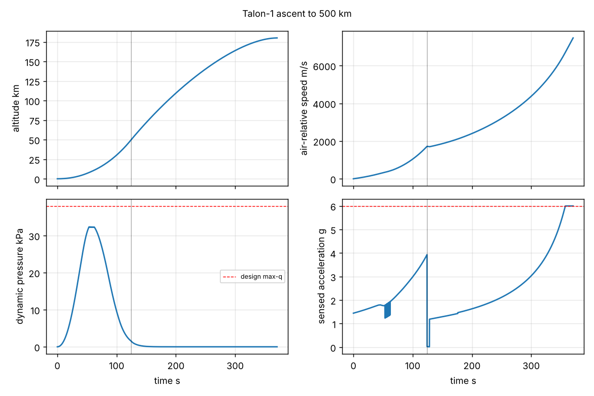

# Talon-1 M2 ascent

Generated by `python -m sim.fly --mission ascent`. Guidance parameters from `gnc/ascent_params.yaml`
(regenerate with `python -m gnc.ascent_opt`).

| Event | Value |
|---|---|
| Guidance | kick 3.157 deg, upper theta0 30.77 deg, c 0.00302 1/s |
| Max-q | 32.3 kPa at T+54 s, 8.3 km, Mach 1.16 (design 38 kPa) |
| Max sensed acceleration | 6.00 g (limit 6.0 g, throttled) |
| MECO / staging | T+124.3 s, 49.6 km, 1721 m/s air-relative, flight path 32.6 deg |
| Fairing separation | T+176.2 s, 92.4 km |
| SECO | T+370.7 s, insertion orbit 179.8 x 500.0 km |
| Apogee circularisation | 91.2 m/s, 28.3 kg |
| Final orbit | 500.0 km circular |
| Upper-stage propellant margin | 158.7 kg |

Notes: point-mass ascent with perfect attitude tracking (the 6-DOF TVC loop arrives in M3); zero-alpha
gravity turn, so the design max-q alpha of 4 deg is the wind allowance.
The positive margin means the M1 dv budget (9300 m/s) was slightly conservative.
